# 🔴 Pokédex React 🎮

> [!NOTE]
> Pokédex interativa com os **151 Pokémon da 1ª geração**: pesquise, filtre por tipo, ordene por atributos, favorite, compare dois Pokémon lado a lado e conheça os treinadores e seus times. Tudo roda no navegador, a partir de um arquivo JSON local.

<table>
  <tr>
    <td width="800">
      <div align="justify">
        Este projeto foi desenvolvido como a **Atividade 03** da disciplina de **Desenvolvimento e Integração de Aplicações Web**. Ele aplica os conceitos fundamentais de **React** (componentes, props, estado, efeitos, hooks customizados e renderização de listas) em uma aplicação completa, com **TypeScript** e **Tailwind CSS** para a interface.
      </div>
    </td>
    <td width="150" align="center">
      <div>
        
      </div>
    </td>
  </tr>
</table>

---

## 🚧 Status do Projeto


---

## 📚 Índice

- [Sobre o Projeto](#-sobre-o-projeto)
- [Funcionalidades Principais](#-funcionalidades-principais)
- [Tecnologias Utilizadas](#-tecnologias-utilizadas)
- [Arquitetura](#-arquitetura)
  - [Diagramas](#diagramas)
  - [Conceitos de React aplicados](#conceitos-de-react-aplicados)
- [Instalação e Execução](#-instalação-e-execução)
  - [Pré-requisitos](#pré-requisitos)
  - [Variáveis de Ambiente](#-variáveis-de-ambiente)
  - [Instalação de Dependências](#-instalação-de-dependências)
  - [Como Executar a Aplicação](#-como-executar-a-aplicação)
- [Estrutura de Pastas](#-estrutura-de-pastas)
- [Dados e Imagens](#-dados-e-imagens)
- [Demonstração](#-demonstração)
- [Documentações utilizadas](#-documentações-utilizadas)
- [Autores](#-autores)
- [Agradecimentos](#-agradecimentos)
- [Licença](#-licença)

---

## 📝 Sobre o Projeto

A **Pokédex React** nasceu como trabalho prático da disciplina de Desenvolvimento e Integração de Aplicações Web. O objetivo era sair do "olá, mundo" e construir uma aplicação React de verdade, com dados estruturados, vários componentes conversando entre si e uma experiência de uso completa.

**Qual problema ele resolve?** Consultar informações de muitos Pokémon rapidamente. Em vez de rolar uma lista enorme, a pessoa pode **pesquisar** por nome ou número, **filtrar** por tipo, **ordenar** por qualquer atributo, **comparar** dois Pokémon e ver **quais treinadores** têm cada um.

**Contexto:** acadêmico, com foco em boas práticas de organização de componentes, tipagem estática e acessibilidade.

**Por que ele é interessante?**

- Os dados vêm de um JSON local, então a aplicação funciona **sem back-end e sem banco de dados**.
- Os cards são tingidos com a **cor do tipo principal** de cada Pokémon, o que torna a lista fácil de escanear.
- Favoritos e tema escuro **persistem** entre as visitas.
- A interface é **responsiva** (desktop, tablet e celular) e **acessível** (teclado, leitores de tela, redução de movimento).

---

## ✨ Funcionalidades Principais

- 🔎 **Pesquisa em tempo real:** por nome ou número, ignorando acentos e maiúsculas (`Bulba`, `25`, `#025`).
- 🏷️ **Filtro por tipo:** 17 tipos presentes nos dados, com chips coloridos.
- ↕️ **Ordenação:** por número, nome ou por qualquer um dos seis atributos (HP, ataque, defesa, ataque especial, defesa especial e velocidade).
- 📇 **Cards informativos:** número, nome, tipos e os 6 atributos de cada Pokémon.
- 🧾 **Detalhes em modal:** barras de atributos, total base, treinadores que possuem o Pokémon e navegação entre anterior/próximo.
- ⭐ **Favoritos:** salvos no `localStorage`, com filtro "só favoritos".
- ⇄ **Comparação lado a lado:** escolha dois Pokémon e veja quem vence em cada atributo.
- ⚄ **Pokémon aleatório:** sorteia entre os resultados filtrados.
- 🧑‍🎓 **Treinadores:** nome, insígnias conquistadas e time completo (clique no Pokémon para abrir os detalhes).
- 🌗 **Tema claro e escuro:** respeita a preferência do sistema e fica salvo.
- 🧩 **Estados vazios amigáveis:** mensagens e botão "Limpar filtros" quando nada é encontrado.
- ♿ **Acessibilidade:** rótulos ARIA, foco visível, modal com `Esc` e `prefers-reduced-motion`.

---

## 🛠 Tecnologias Utilizadas

As versões exatas estão no `package.json`. Recomenda-se usar as versões instaladas pelo template do Vite (ou superiores).

### 💻 Front-end

- **Biblioteca:** [React](https://react.dev/) (componentes funcionais e hooks)
- **Linguagem:** [TypeScript](https://www.typescriptlang.org/) em modo estrito (`.ts` e `.tsx`)
- **Estilização:** [Tailwind CSS v4](https://tailwindcss.com/) via plugin `@tailwindcss/vite` (sem arquivos `.css` por componente)
- **Gerenciamento de estado:** hooks nativos (`useState`, `useMemo`, `useCallback`) e um hook próprio, `useLocalStorage<T>`
- **Build Tool:** [Vite](https://vite.dev/)
- **Fontes:** Bricolage Grotesque e Figtree (Google Fonts)

### 🖥️ Back-end

- **Não possui.** Os dados ficam em `src/data/pokedex-data.json` e são importados diretamente pela aplicação.

### 🖼️ Recursos externos

- **Imagens:** repositório público de sprites da [PokéAPI](https://github.com/PokeAPI/sprites), carregadas por URL a partir do ID do Pokémon.

---

## 🏗 Arquitetura

A aplicação é uma **SPA (Single Page Application)** organizada em **componentes**. Todo o estado compartilhado fica no componente `App`, que distribui dados para baixo via **props** e recebe eventos de volta via **callbacks**.

**Decisões arquiteturais**

- **Estado derivado com `useMemo`:** a lista exibida (filtrada e ordenada) é calculada a partir do estado, e não guardada em um `useState` separado. Isso evita inconsistências.
- **Funções puras em `utils/`:** `filterPokemon`, `sortPokemon` e `totalStats` não dependem do React, então são fáceis de testar.
- **Tipos centralizados em `types.ts`:** `Pokemon`, `Trainer`, `SortKey`, `PokedexData` etc., usados por todos os componentes.
- **Hook customizado `useLocalStorage<T>`:** encapsula a persistência de favoritos e tema, com tratamento de erro quando o armazenamento não está disponível.
- **Cores dinâmicas por tipo:** como o Tailwind não gera classes para valores conhecidos só em tempo de execução, cada card define uma variável CSS inline (`--tc`) e as classes a consomem (`bg-type-glow`, `hover:border-(--tc)`).
- **Tema por variáveis CSS:** as cores semânticas (`bg-surface`, `text-ink`, `border-line`) trocam entre claro e escuro pelo atributo `data-theme`, sem repetir `dark:` em cada classe.
- **Imagem com fallback:** `PokemonImage` tenta a arte oficial, depois o sprite pequeno e, por fim, um placeholder.
- **Navegação sem roteador:** as duas "páginas" (Pokédex e Treinadores) são alternadas por estado, o que mantém o projeto simples.

### Diagramas

**Árvore de componentes**

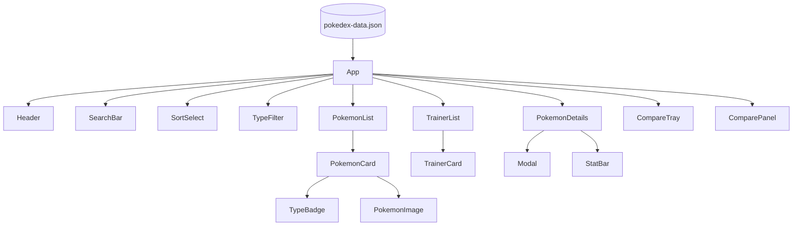

**Fluxo de dados da lista**

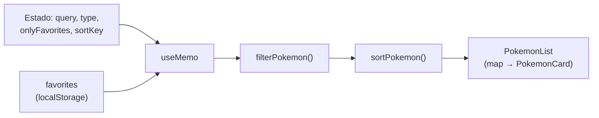

### Conceitos de React aplicados

| Conceito | Onde aparece |
| --- | --- |
| Componentes funcionais e props tipadas | todos os arquivos em `src/components/` |
| `useState` | `App.tsx` (busca, tipo, ordenação, seleção, comparação, aba atual) |
| `useMemo` (estado derivado) | `App.tsx` — lista filtrada e ordenada |
| `useEffect` | `App.tsx` (tema), `Modal.tsx` (tecla Esc e foco), `useLocalStorage.ts` |
| `useCallback` | `App.tsx` — handlers estáveis passados ao `Modal` |
| `useRef` | `Modal.tsx` — foco no botão de fechar |
| Hook customizado | `hooks/useLocalStorage.ts` |
| Renderização de listas com `map()` | `PokemonList`, `TypeFilter`, `TrainerList`, `TrainerCard` |
| Renderização condicional | estado vazio, modais, bandeja de comparação |
| Eventos | cliques, `onChange`, teclado (`Esc`) |

---

## 🔧 Instalação e Execução

### Pré-requisitos

- **Node.js:** versão **20.19** ou superior (exigência das versões atuais do Vite)
- **Gerenciador de pacotes:** npm (já vem com o Node.js)
- **Git** (para clonar o repositório)

Confira com:

```bash
node -v
npm -v
```

---

### 🔑 Variáveis de Ambiente

**Nenhuma variável de ambiente é necessária.** O projeto não usa chaves de API, banco de dados nem serviços privados. Basta instalar e executar.

---

### 📦 Instalação de Dependências

1. **Clone o repositório:**

```bash
git clone <URL_DO_SEU_REPOSITÓRIO>
cd <pasta-do-projeto>
```

2. **Instale as dependências:**

```bash
npm install
```

---

### ⚡ Como Executar a Aplicação

**Modo de desenvolvimento** (com atualização automática):

```bash
npm run dev
```

🎨 *A aplicação estará disponível em **<http://localhost:5173>**.*

**Build de produção** (verifica os tipos com o `tsc` e gera a pasta `dist/`):

```bash
npm run build
```

**Pré-visualizar o build de produção localmente:**

```bash
npm run preview
```

---

## 📂 Estrutura de Pastas

```
.
├── .gitignore                    # 🧹 Ignora node_modules, dist etc.
├── README.md                     # 📘 Documentação principal do projeto.
├── index.html                    # 🌐 Página base (fontes, favicon, ponto de montagem do React).
├── package.json                  # 📦 Dependências e scripts.
├── vite.config.ts                # ⚙️ Plugins do Vite (React e Tailwind).
├── tsconfig.json                 # 🛠️ Referências dos tsconfigs (gerado pelo template do Vite).
├── tsconfig.app.json             # 🛠️ Opções do TypeScript para o código em src/.
├── tsconfig.node.json            # 🛠️ Opções do TypeScript para arquivos de configuração.
│
├── /public
│   └── favicon.svg               # 🔴 Ícone da aplicação.
│
└── /src
    ├── main.tsx                  # 🚪 Ponto de entrada: monta o <App /> no DOM.
    ├── App.tsx                   # 🧠 Estado global e composição das telas.
    ├── index.css                 # 🎨 Import do Tailwind, tema (cores, fontes, animações) e utilitários próprios.
    ├── types.ts                  # 🧬 Interfaces e tipos (Pokemon, Trainer, SortKey, PokedexData…).
    ├── vite-env.d.ts             # 📎 Tipos do Vite.
    │
    ├── /components               # 🧱 Componentes de interface
    │   ├── Button.tsx            #     Botão reutilizável (primary, outline, ghost).
    │   ├── Header.tsx            #     Marca, abas (Pokédex/Treinadores) e botão de tema.
    │   ├── SearchBar.tsx         #     Campo de pesquisa.
    │   ├── TypeFilter.tsx        #     Chips de filtro por tipo.
    │   ├── SortSelect.tsx        #     Seletor de ordenação.
    │   ├── PokemonList.tsx       #     Grade de cards (usa map()).
    │   ├── PokemonCard.tsx       #     Card com atributos, favoritar e comparar.
    │   ├── PokemonDetails.tsx    #     Modal de detalhes.
    │   ├── PokemonImage.tsx      #     Imagem com fallback.
    │   ├── StatBar.tsx           #     Barra de atributo.
    │   ├── TypeBadge.tsx         #     Etiqueta colorida de tipo.
    │   ├── Modal.tsx             #     Modal acessível (Esc, foco, trava de scroll).
    │   ├── CompareTray.tsx       #     Bandeja fixa com os Pokémon escolhidos.
    │   ├── ComparePanel.tsx      #     Comparação lado a lado.
    │   ├── TrainerList.tsx       #     Lista de treinadores.
    │   ├── TrainerCard.tsx       #     Card de treinador (insígnias e time).
    │   └── EmptyState.tsx        #     Mensagem de "nada encontrado".
    │
    ├── /hooks
    │   └── useLocalStorage.ts    # 💾 Estado persistido no navegador.
    │
    ├── /utils
    │   ├── helpers.ts            # 🛠️ Filtro, ordenação, formatação e URLs de imagem.
    │   └── typeColors.ts         # 🎨 Cor de cada tipo e cálculo de contraste do texto.
    │
    └── /data
        └── pokedex-data.json     # 📦 Pokémon, tipos e treinadores.
```

---

## 🗃️ Dados e Imagens

**Dados.** O arquivo `src/data/pokedex-data.json` é o fornecido na atividade:

| Coleção | Quantidade | Campos |
| --- | --- | --- |
| `pokemon` | 151 | `id`, `name`, `stats` (6 atributos) e `types` |
| `types` | 18 registros (17 usados) | `id`, `name` |
| `trainers` | 12 | `id`, `name`, `badges`, `pokemonIds` |

O registro "Typeless" (id 0) não é usado por nenhum Pokémon, por isso o filtro mostra 17 tipos.

**Imagens.** São carregadas do repositório de sprites da PokéAPI:

```
https://raw.githubusercontent.com/PokeAPI/sprites/master/sprites/pokemon/other/official-artwork/{id}.png
```

> ⚖️ **Aviso:** Pokémon e seus nomes e imagens são marcas e propriedades de Nintendo, Creatures Inc. e GAME FREAK Inc. Este é um projeto **educacional e sem fins lucrativos**.

---

## 🎥 Demonstração

<!--
  Para inserir uma imagem, troque "*Sua imagem aqui*" por:
  [](URL_DA_IMAGEM)
-->

### 🌐 Aplicação Web (desktop)

| Tela | Captura de Tela |
| --- | --- |
| **Pokédex (lista de cards)** | **Detalhes do Pokémon (modal)** |
| [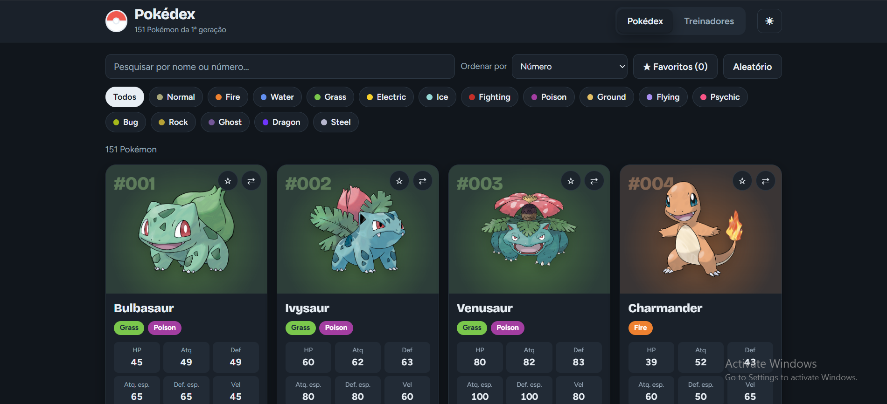](docs/demo/Print_Desktop_1.png) | [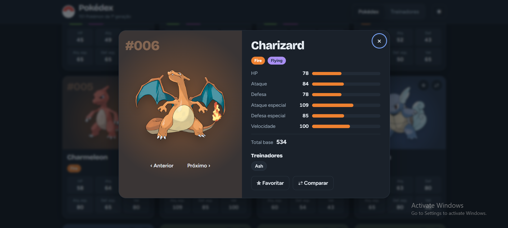](docs/demo/Print_Desktop_2.png) |
| **Comparação lado a lado** | **Treinadores** |
| [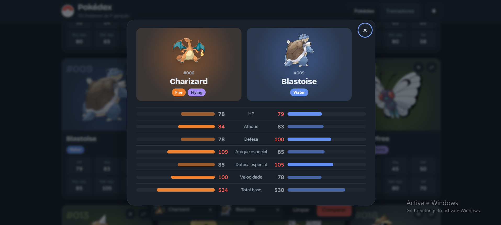](docs/demo/Print_Desktop_3.png) | [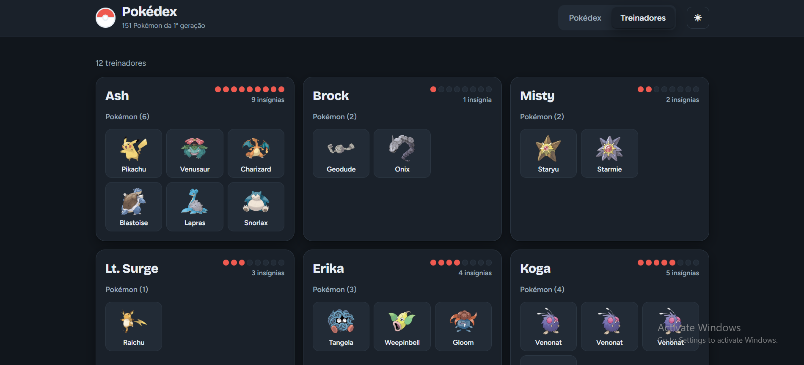](docs/demo/Print_Desktop_4.png) |
| **Tema claro** | **Nenhum Pokémon encontrado** |
| [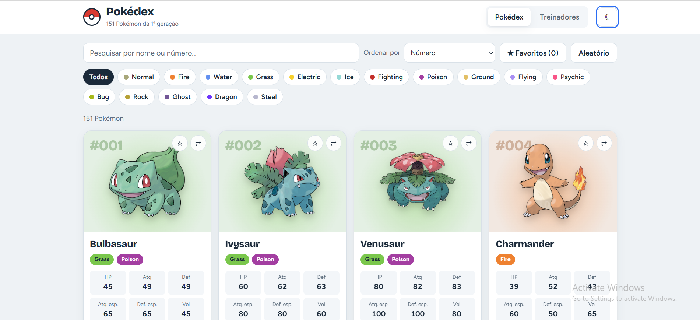](docs/demo/Print_Desktop_5.png) | [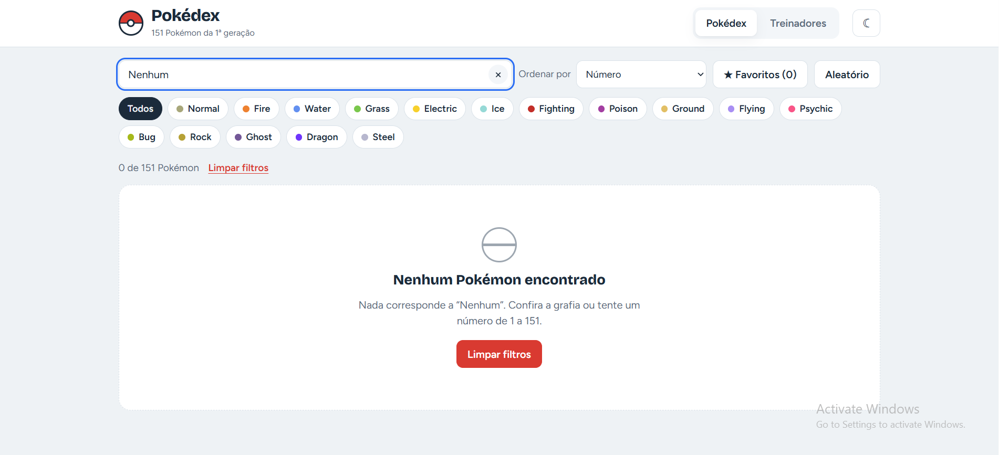](docs/demo/Print_Desktop_6.png) |

### 📱 Versão Mobile (responsiva)

| Lista | Detalhes | Detalhes |
| --- | --- | --- |
| [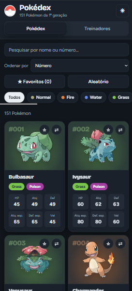](docs/demo/Print_Mobile_1.png) | [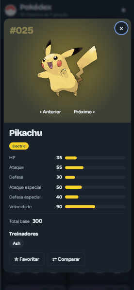](docs/demo/Print_Mobile_2.png) | [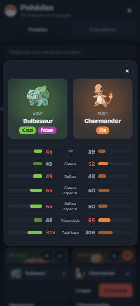](docs/demo/Print_Mobile_3.png) |

---

## 🔗 Documentações utilizadas

- 📖 **React:** [Documentação oficial](https://react.dev/reference/react)
- 📖 **Vite:** [Guia oficial](https://vite.dev/guide/)
- 📖 **TypeScript:** [Documentação oficial](https://www.typescriptlang.org/docs/)
- 📖 **Tailwind CSS v4:** [Documentação oficial](https://tailwindcss.com/docs)
- 📖 **Sprites dos Pokémon:** [PokeAPI/sprites](https://github.com/PokeAPI/sprites)
- 📖 **Atividade e template de README:** [Atividade 03](https://github.com/joaopauloaramuni/desenvolvimento-e-integracao-de-aplicacoes-web/blob/main/ATIVIDADES/ATIVIDADE%2003.md) · [Template README](https://github.com/joaopauloaramuni/desenvolvimento-e-integracao-de-aplicacoes-web/blob/main/TEMPLATES/template_README.md)

---

## 👥 Autores

| Nome | Foto | GitHub | LinkedIn | Gmail |
|---------|----------|-----------------|-------------|-----------|
| Bernardo Guedes  | <div align="center"></div> | <div align="center"><a href="https://github.com/Bernardo-Guedes"></a></div> | <div align="center"><a href="https://www.linkedin.com/in/bernardoguedes"></a></div> | <div align="center"><a href="mailto:bguedessilveira@gmail.com"></a></div> |

---

## 🙏 Agradecimentos

- [**Prof. Dr. João Paulo Aramuni**](https://github.com/joaopauloaramuni) — Pelos valiosos ensinamentos sobre Arquitetura de Software e Padrões de Projeto.

---

## 📄 Licença

Este projeto é distribuído sob a **Licença MIT**.